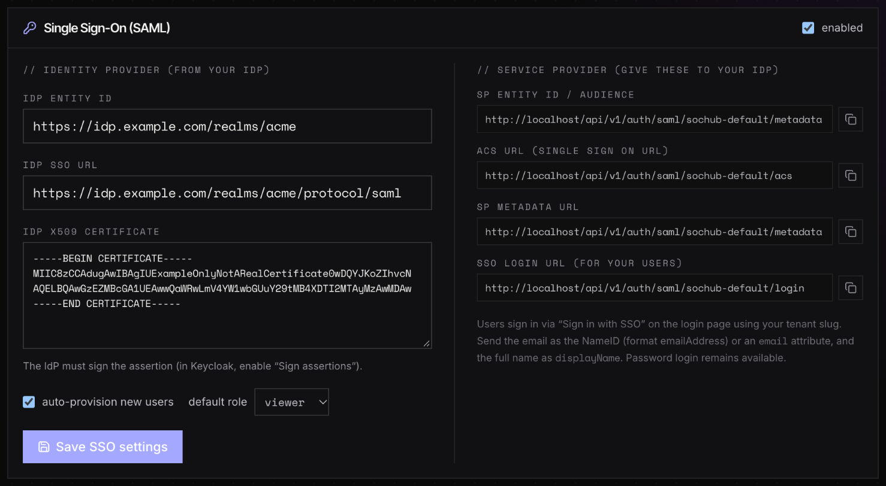
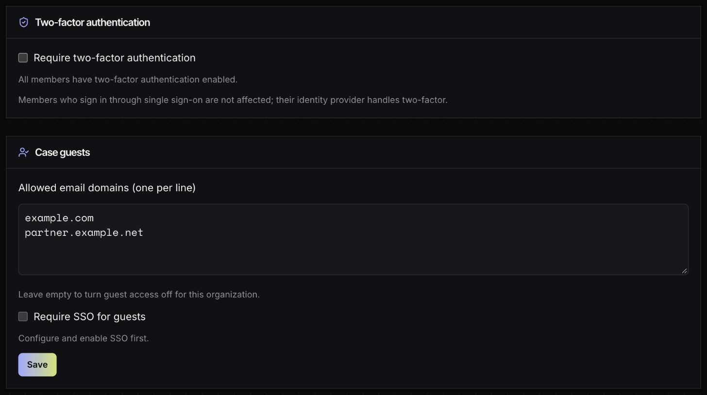
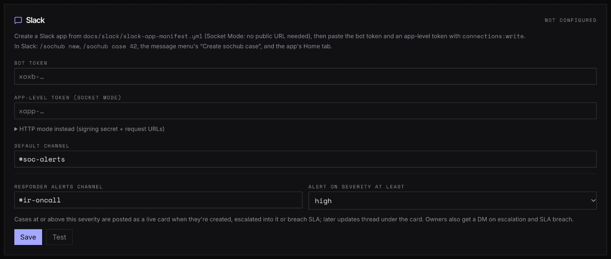
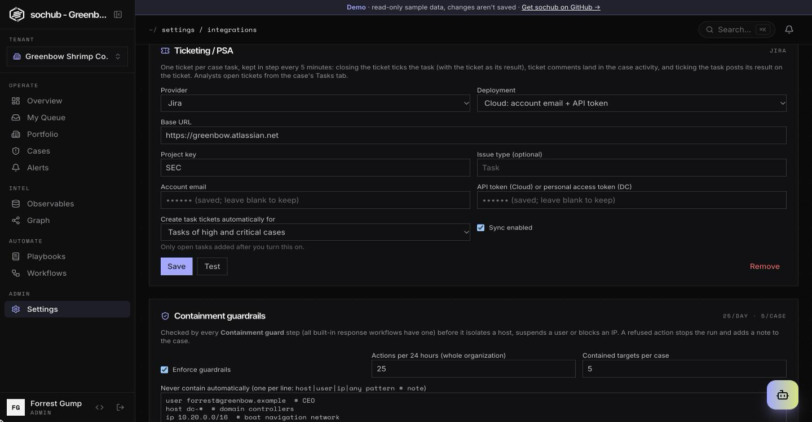
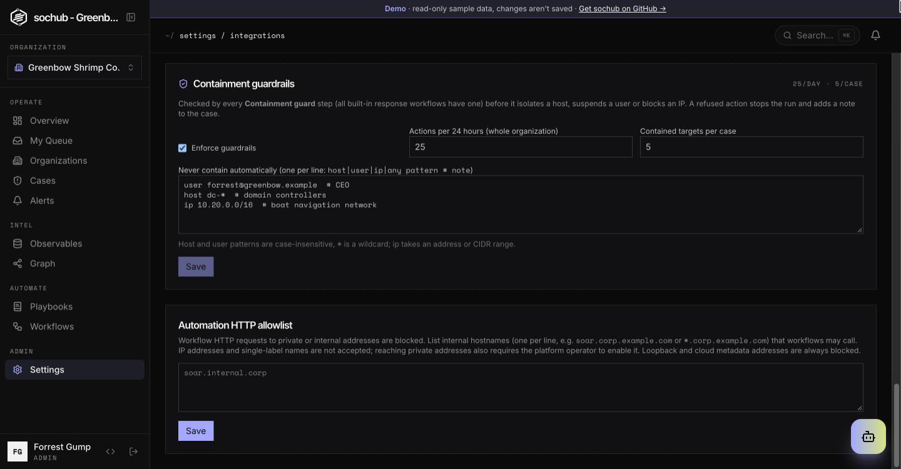
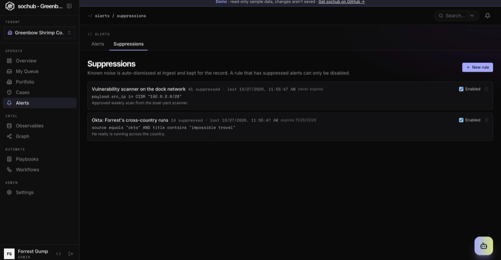

# Configuration guide: getting it right

A walkthrough of the settings people most often get wrong, what each screen expects, and what
the error you are looking at means. For the full list of environment variables see
[Configuration](configuration.md).

- [1. Before the first boot](#1-before-the-first-boot)
- [2. Single sign-on (SAML)](#2-single-sign-on-saml)
- [3. Two-factor authentication](#3-two-factor-authentication)
- [4. Case guests](#4-case-guests)
- [5. Slack](#5-slack)
- [6. AI copilot](#6-ai-copilot)
- [7. Uploads and storage](#7-uploads-and-storage)
- [8. Ticketing / PSA](#8-ticketing--psa)
- [9. Containment guardrails](#9-containment-guardrails)
- [10. Email: "was this you?" and weekly client summaries](#10-email-was-this-you-and-weekly-client-summaries)
- [11. Alert suppression](#11-alert-suppression)
- [Quick health check](#quick-health-check)

## 1. Before the first boot

With `ENVIRONMENT=production` (the default) the backend **refuses to start** with weak secrets.
Outside production the same checks only print warnings.

| Setting | Where | Get it right |
|---|---|---|
| `SECRET_KEY` | `backend/.env` | At least 32 random characters: `python -c "import secrets; print(secrets.token_urlsafe(48))"`. Changing it later signs everyone out, and (unless `ENCRYPTION_KEY` is set and `python -m app.scripts.reencrypt_secrets` has run) makes stored Slack/integration secrets undecryptable. |
| `ENCRYPTION_KEY` | `backend/.env` | Optional, recommended: a separate ≥32-character key for stored secrets. See [configuration.md](configuration.md#encryption-at-rest-and-key-rotation) before setting or changing it. |
| `POSTGRES_PASSWORD` | root `.env` | Not the compose default. Applied only when the database volume is **first** created; changing it afterwards does not change the database password. |
| `REDIS_PASSWORD` | root `.env` | Required, and not a known default. |
| `PUBLIC_BASE_URL` | root/backend `.env` | The URL users type, e.g. `https://soc.example.com`. SAML URLs and post-login redirects are built from it. |
| `FRONTEND_URL` | backend `.env` | Same public URL; used in invitation, guest and Slack links. |

The error text tells you which one failed, for example:

```
ValueError: SECRET_KEY is weak: it is a known placeholder or shorter than 32 characters. ...
ValueError: REDIS_URL has no password. Run Redis with --requirepass ...
ValueError: DATABASE_URL uses the local-development default password. ...
```

> `PUBLIC_BASE_URL` and `FRONTEND_URL` still say `http://localhost` in production? SSO, invitations and
> Slack buttons will point people at their own machine. Set both before configuring anything below.

## 2. Single sign-on (SAML)

**Settings → Tenant → Single Sign-On (SAML)** (tenant admins).



### Step 1: register sochub in your identity provider

Copy the values from the right-hand column of the screen into a new SAML application in your IdP:

| IdP field (names vary) | Value from sochub |
|---|---|
| Entity ID / Audience / Identifier | **sp entity id / audience** |
| ACS URL / Reply URL / Single sign-on URL | **acs url** (`…/api/v1/auth/saml/<tenant-slug>/acs`) |
| Metadata (if your IdP can import it) | **sp metadata url** |
| Name ID format | `urn:oasis:names:tc:SAML:1.1:nameid-format:emailAddress` |
| Sign assertions | **On**. Unsigned assertions are rejected. Signing only the response envelope is not enough. |

If these URLs start with `http://localhost`, fix `PUBLIC_BASE_URL` first (see section 1) and reload.

### Step 2: send the right attributes

sochub needs an **email** to find or create the user, and uses a **display name** when it creates one.

| What | Where sochub looks, in order | Required |
|---|---|---|
| Email | The **NameID**, if it contains an `@`. Otherwise the first attribute found among `email`, `mail`, `urn:oid:0.9.2342.19200300.100.1.3`, `http://schemas.xmlsoap.org/ws/2005/05/identity/claims/emailaddress` | Yes |
| Full name | The first non-empty attribute among `displayName`, `cn`, `name`, `http://schemas.xmlsoap.org/ws/2005/05/identity/claims/name` | No. Falls back to the part of the email before `@` |

The simplest setup that works everywhere: **NameID = the user's email** (format `emailAddress`) plus an
attribute named **`displayName`** holding the full name.

Provider hints:

- **Okta**: *Name ID format* `EmailAddress`, *Application username* `Email`. Add an attribute statement
  `displayName` = `user.displayName`.
- **Microsoft Entra ID**: under *Attributes & Claims*, set the *Unique User Identifier (Name ID)* to
  `user.mail` with format *Email address*. The default `user.userprincipalname` only works if UPNs are
  real email addresses. The default `…/claims/emailaddress` and `…/claims/name` claims are also understood.
- **Keycloak**: on the client, set *Name ID format* to `email`, turn on *Force name ID format* and
  *Sign assertions*. Add a mapper that sends the user's full name as `displayName`.

### Step 3: paste the IdP values and enable

Fill **idp entity id**, **idp sso url** and the **idp x509 certificate** (the IdP's *signing* certificate,
PEM, `-----BEGIN CERTIFICATE-----` included), tick **enabled** and **Save SSO settings**. All three fields are
required to enable SSO.

### Who can sign in

| Situation | Result |
|---|---|
| Email matches a user who belongs **only to this tenant** | Signed in. |
| No user with that email, **auto-provision** on | User created with the **default role** (viewer or analyst). They are SSO-only: no password. |
| No user with that email, auto-provision off | Refused: "No account for this email. Ask your admin for an invitation." |
| User also belongs to another tenant, or is a super admin | Refused: they keep signing in with their password. |
| User is deactivated | Refused: "Your account is deactivated." |

Password login stays available for accounts that have a password.

### SSO errors on the login page

| Message | Fix |
|---|---|
| `SSO sign-in failed: <reason>` | Usually the certificate (paste the IdP's current **signing** cert), unsigned assertions, or an audience/ACS mismatch (re-copy the SP values; check `PUBLIC_BASE_URL`). Clock skew of several minutes between IdP and server also lands here. |
| `SSO response did not include an email address.` | NameID is not an email and none of the email attributes above is sent. See step 2. |
| `SSO is not enabled for this tenant.` | Tick **enabled** and save, or the user typed the wrong tenant slug. |
| `This account can't use single sign-on for this organization` | See "Who can sign in". |
| `Your sign-in session expired or was already used. Please start the sign-in again.` | The SAML response did not answer a sign-in started from this browser in the last 10 minutes (or it was already used). Start from the SoC Hub login page. If users start from the IdP's app dashboard, see below. |

Every failure is also written to **Settings → Audit log** with a reason code (`saml_invalid`, `no_email`,
`not_allowed`, `replay`, `not_enabled`, `unsolicited`).

**IdP-initiated sign-in** (starting from the IdP's app dashboard) is refused by default: the ACS only accepts a
response to a request this browser started (its id is kept server-side for 10 minutes behind an HttpOnly
`sochub_saml` cookie, `SameSite=None; Secure` over https, and is single use). Tick **allow IdP-initiated
sign-in** to accept unsolicited responses too. That exposes the tenant to login CSRF: anyone with an account at
the same IdP can silently sign a colleague's browser into their own account. Assertions are still single use.

## 3. Two-factor authentication

**Settings → Tenant → Two-factor authentication**.



- **Require two-factor authentication** applies to members who sign in with a **password**. They are asked
  to set it up at their next sign-in, and can't switch into this tenant until they do.
- Members who sign in through **SSO are not affected**: their identity provider handles two-factor, so
  enforce it there. They are not counted as "members without MFA", and their profile says
  *"Two-factor authentication is handled by single sign-on."*
- A user's own setting lives in **Settings → Profile**. If the tenant requires two-factor, they can't turn
  it off. An admin can reset a user's two-factor from **Settings → Users** (for example, a lost phone).

## 4. Case guests

Same screen as above, **Case guests** section. Guests are outside people (a client, a vendor) invited to
a single case.

- **Allowed email domains**: one per line (`example.com`). Only addresses in these domains can be invited.
  **Empty = guest access is off** for the whole tenant.
- **Guest sign-in**: `Password`, `SAML` or `OIDC`. An SSO protocol is only selectable once it is configured
  in section 2, and it turns password sign-in off for guests. Guests then sign in through your IdP and need a
  matching active invitation. Members' method is set separately (**Member sign-in**, section 2); see
  [Login methods and OIDC SSO](sso/oidc.md).
- Click **Save**; a green **✓ Saved** confirms it. An invalid domain is reported as
  "Not a valid domain: …".

## 5. Slack

**Settings → Integrations → Slack**. Full walkthrough: [Slack setup](slack/setup.md).



- Create the app from `docs/slack/slack-app-manifest.yml`. Socket Mode is the default: no public URL needed.
- Paste the **bot token** (`xoxb-…`) and the **app-level token** (`xapp-…`, scope `connections:write`).
  A token that doesn't start with `xapp-` is rejected.
- Socket Mode needs the **`slack-socket`** service running. The card shows *socket connected* once it is.
- Click **Test** after saving: it stores the workspace id, and buttons and commands are ignored until then.
- **Responder alerts** need a minimum severity (not "off") and the bot **invited to that channel**.
- Analysts can only act from Slack if the **email on their Slack profile** matches their sochub account.

"Slack credentials can't be decrypted (SECRET_KEY changed?)" means the encryption key changed (see
[key rotation](configuration.md#encryption-at-rest-and-key-rotation)): restore the old key, or re-enter the tokens.
More symptoms are in the [Slack troubleshooting table](slack/setup.md#troubleshooting).

## 6. AI copilot

- With no `AI_PROVIDER`, sochub uses the bundled Ollama with `OLLAMA_MODEL=llama3.2:3b`, which needs about
  4 GB of free RAM. Larger models on a small host get killed for running out of memory, and the copilot
  then never answers.
- `AI_*` settings go in **`backend/.env`**, not the root `.env`: compose does not pass them through.
- Hosted providers: set `AI_PROVIDER`, `AI_MODEL` and `AI_API_KEY` (see `backend/.env.example`). Tenant
  admins can override the provider per tenant unless `AI_ALLOW_TENANT_OVERRIDE=false`.
- **AWS Bedrock**: use an **inference profile id** as the model (e.g. `us.anthropic.claude-sonnet-4-5-20250929-v1:0`),
  grant `bedrock:InvokeModel*` on foundation models in **every** region the profile routes to, and complete the
  Anthropic use-case form once per account. Policy, first-use rules and an error table:
  [Bedrock permissions and model access](configuration.md#bedrock-permissions-and-model-access).
- Slow answers: the backend waits `AI_TIMEOUT_SECONDS` (120 s by default) and nginx waits 300 s. A
  "didn't answer in time" banner usually means the model is too large for the hardware.
- Use **Clear** in the copilot header to start a fresh conversation; old context otherwise carries over.

## 7. Uploads and storage

- `MAX_UPLOAD_MB` (100 by default) caps attachments in both the backend and nginx.
- Local storage writes to the `attachments_data` volume as **uid 10001**. If you bind-mount a host folder
  instead, `chown -R 10001 <folder>` or uploads fail with permission errors.
- `STORAGE_BACKEND=s3` requires `S3_BUCKET`; the backend won't start without it.

## 8. Ticketing / PSA

**Settings → Integrations → Ticketing / PSA** (admins), one connection per organization:



| Provider | Base URL | Credentials | Settings |
|---|---|---|---|
| Jira Cloud | `https://<site>.atlassian.net` | account email + API token | project key, issue type (default Task) |
| Jira Cloud (service account) | `https://<site>.atlassian.net` (used for links) | service account OAuth 2.0 client ID + secret | project key, issue type, **cloud ID** |
| Jira Data Center | your Jira URL | personal access token | project key, issue type |
| HaloPSA | `https://<instance>.halopsa.com` | API application client ID + secret (client credentials) | ticket type ID, client ID, Halo tenant (hosted Halo) |
| ConnectWise Manage | `https://<region>.myconnectwise.net/v4_6_release/apis/3.0` | company ID, public + private key, clientId | service board ID, company identifier |

- **Test** signs in and reads the project or board; nothing is created.
- **Jira service account** (recommended for Cloud: no person's token): in admin.atlassian.com create a **service
  account**, give it access to the Jira project, then **Create credentials > OAuth 2.0** with the Jira scopes for
  reading and writing issues and comments. Paste the client ID and secret. The **cloud ID** is the `cloudId` value
  at `https://<site>.atlassian.net/_edge/tenant_info`. SOC Hub gets a 60-minute token from
  `auth.atlassian.com/oauth/token` and calls `api.atlassian.com/ex/jira/<cloud ID>/rest/api/3`; ticket links still
  point at your site.
- The Atlassian **organization admin API key** can't read or create Jira issues. It's for the *Atlassian: pull
  organization audit log* and *Atlassian: suspend user access* workflow templates (Workflows → templates).
- Credentials are write-only. Leaving them blank on save keeps the stored ones, but only for the same provider at
  the same host: change the host and you must enter them again.
- **Create tickets automatically for** a severity and above only applies to cases created after you turn it on.
- **Post analyst notes to the ticket** is off by default because PSA tickets are often visible to the client. When on,
  notes go as internal notes in HaloPSA and ConnectWise.
- The sync runs every 5 minutes on the Celery beat (`sync-tickets`); errors show on the card ("Last sync: …").
- Hosts on private addresses need the tenant's HTTP allowlist and `WORKFLOW_ALLOW_PRIVATE_ALLOWLIST`, as for
  workflows. The old `JIRA_URL` / `JIRA_USER` / `JIRA_API_TOKEN` variables are ignored.

## 9. Containment guardrails



**Settings → Integrations → Containment guardrails** (admins). Defaults apply until you save: 25 automated actions
per 24 hours and 5 contained targets per case, nothing protected.

- **Never contain automatically**, one per line: `user ceo@acme.com  # VIP`, `host dc-*`, `ip 10.0.0.0/24`,
  `any *-prod-db`. An IP target that is a range overlapping a protected range, or isn't a valid address, is refused.
- A refused action stops the workflow run and adds a note to the case saying why; nothing is sent to the vendor.
- Turning **Enforce guardrails** off lets every guarded step through (actions are still listed on the case).
- Your own workflows get the same protection by adding a **Containment guard** step before the step that acts.

## 10. Email: "was this you?" and weekly client summaries

Both need outgoing email: `SMTP_HOST`, `SMTP_PORT`, `SMTP_FROM_EMAIL` (and `SMTP_USER` / `SMTP_PASSWORD` when your
relay needs them) in `backend/.env`, and `FRONTEND_URL` set to the address people open in a browser.

- **Ask user (email)** steps and the *Ask the user by email: was this you?* template email a link to
  `FRONTEND_URL/verify/<token>`. If `FRONTEND_URL` is wrong the link is dead and the question times out. Without SMTP
  the step fails with "email is not set up on this server".
- **Weekly client summaries** (Portfolio → a client's summary → *Change recipients*, that client's admins): the beat
  task checks hourly and sends at most once a week per client. Without SMTP nothing is sent and nothing retries
  every hour.

## 11. Alert suppression



**Alerts → Suppressions** (analysts and admins). Before saving a rule, press **Preview**: it shows how many of the last
500 alerts it would have caught and warns when that's most of them. Give every rule an expiry unless the noise is
permanent. A rule that has suppressed alerts can only be disabled, not edited or deleted, so its history stays
explainable; create a new rule instead. Rules drafted by AI clients over MCP arrive disabled.

## Quick health check

```bash
docker compose ps                              # everything "running"/"healthy", incl. slack-socket if used
docker compose logs backend | grep -i error    # boot-time config errors show up here
docker compose exec backend alembic current    # should print the latest revision ("(head)")
curl -s http://localhost/api/v1/auth/saml/<tenant-slug>/metadata | head   # SP metadata for your IdP
```
