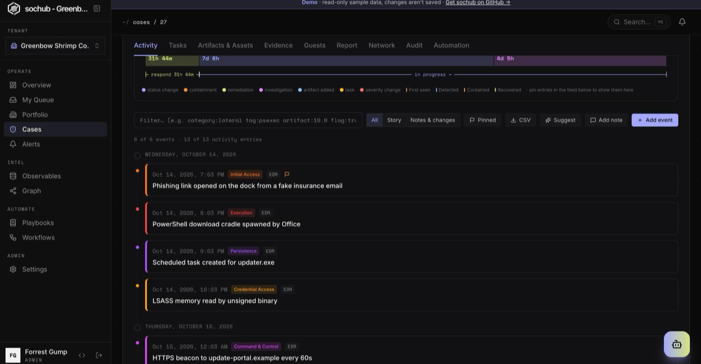
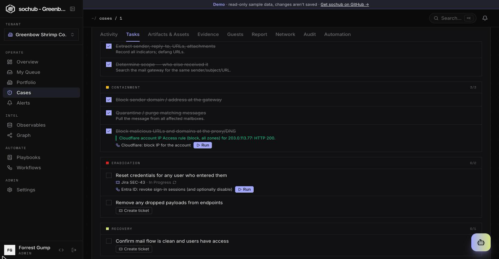
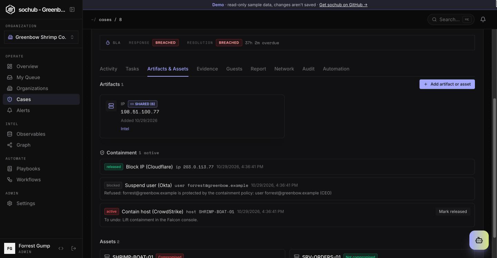
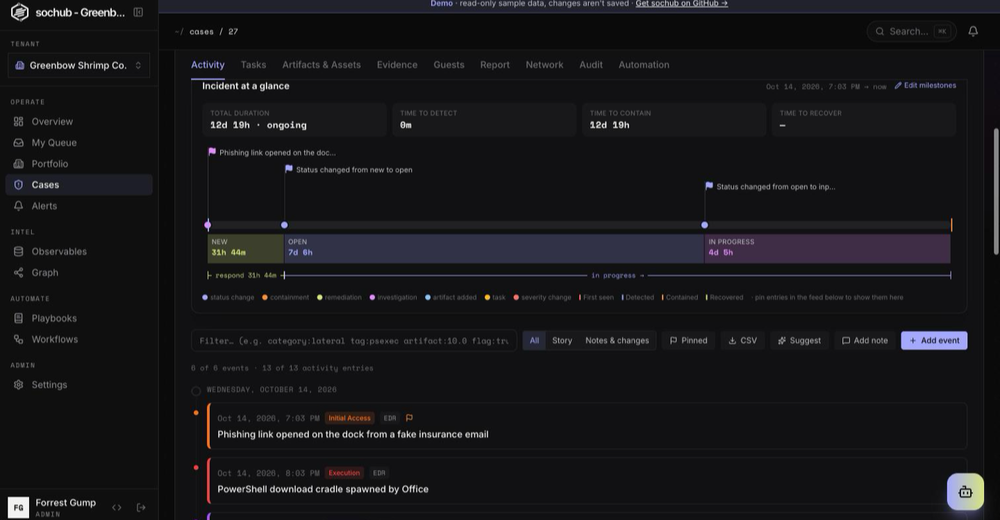
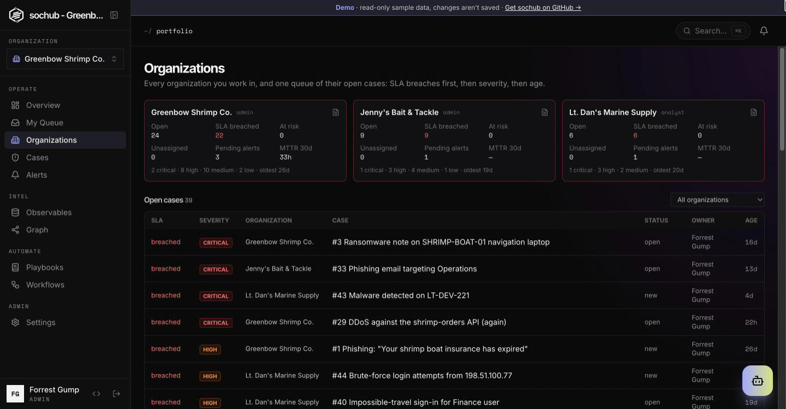

# Features

## Cases & investigation

Create and work security cases with severity/status, tags, a description, attached **artifacts**, **assets** and
**IOCs**, and an **audit trail**. A case has these tabs:

- **Activity**: the incident glance on top, then one chronological feed of everything: investigation events (what
  happened, dated when it happened, with an ATT&CK category), notes and comments (@mentions, guest sharing, edit),
  ticket comments and status, containment, and system changes. **Add note** (stamped now) and **Add event** (dated
  when it happened; the category picker explains each category). Filter by **All / Story / Notes & changes**, by
  text (`category:`, `tag:`, `artifact:`…) or **Pinned**; export to CSV; **Suggest** drafts events from alerts and notes.
- **Tasks**: phase-grouped playbook tasks. A task can link a workflow: **Run** starts it on the case, and a workflow's
  *Complete task* step records the outcome on the task (colour-coded) and ticks it.
- **Artifacts & assets**: one **Add** dialog asks which you're adding: an **artifact** (evidence of the attacker: IP,
  domain, hash…, enrichable, promotable to an IOC) or an **asset** (a host, account or service of yours, with its
  compromise status). The **Containment** list shows what automations contained, refused or released.
- **Evidence**, **Guests**, **Report**, **Automation**, **Audit**, and **Network**: the investigation graph limited to
  this case and whatever its artifacts and IOCs connect to (two hops).

The case header shows the SLA, AI triage, the Slack war room and, when ticketing is set up, the linked ticket
(**Create ticket**, status, **Sync now**).

**Incident milestones.** Every case has four milestones: **First seen**, **Detected**, **Contained** and
**Recovered**. Each is computed from case data (earliest IOC or alert, case creation, last completed containment
task, resolution) until an analyst declares an exact time. Declare them from **Edit milestones** on the glance,
the report's Milestones panel, an investigation event's **Set as…** menu, or the **Incident started** field when
creating a case (it is only used if you change it from "now"). The glance, the report and the TTD/TTC/TTR
durations all read the same values. Saving a time that would put milestones out of order is refused; an
inconsistency that already existed in the computed values never blocks an unrelated edit.

**Incident at a glance** (top of the Activity tab) shows the incident on one time axis: milestone markers, status
phases and only the items you chose. Status and severity changes always appear; investigation events and notes
appear when pinned (the flag or pin on the entry). A declared First seen earlier than the case adds a "before case"
phase. Clicking an item scrolls the feed to it.

## Multi-tenancy

One account can belong to **many tenants** with a **different role per tenant**.

| Role | Scope | Can |
|---|---|---|
| `super_admin` | Global | Manage all tenants, switch into any, create admins, author marketplace playbooks |
| `admin` | Per tenant | Manage members, configure SSO, import/author playbooks |
| `analyst` | Per tenant | Create/update cases, artifacts, tasks |
| `viewer` | Per tenant | Read-only |

The active tenant rides in the JWT; switch it from the sidebar picker
(`POST /auth/switch-tenant`). All data is row-isolated by `tenant_id`.

### Portfolio (MSSP view)

Users who belong to more than one tenant get **Portfolio** in the sidebar: one card per client (open cases,
SLA breached and at risk, unassigned, pending alerts, 30-day MTTR, oldest open case) and one queue of every
client's open cases, ordered SLA-breached first, then severity, then age. Opening a case of another client
switches the active tenant first, with the same checks as the tenant switcher.

- Only tenants this session could switch into right now appear: a client that requires SSO or two-factor the
  session doesn't have is left out (the page says how many), as are deactivated tenants. Super admins, who
  can switch into any tenant, see every active tenant (the first 100 by name) and appear in the portfolio's
  platform audit like any other read.
- **Client summary** (the document icon on a card): the last 7, 30 or 90 days of cases opened and resolved
  with outcomes, MTTR, SLA breaches, alerts received/promoted/dismissed/suppressed and notable cases, as text
  to copy into an email or report. That client's admins can set up to 10 recipients for a **weekly email** of
  the 7-day summary (sent hourly-checked, at most once a week; the first one within the hour).
## Investigation Copilot

A global, context-aware assistant. It runs on the configured AI provider, which is
local Ollama by default (see [AI providers](#ai-providers)).

- **Auto-scoped** — on a case page it has the full case context; elsewhere it's a
  tenant-level assistant. Conversations persist per case and as one general session.
- **Actions (propose → confirm)** — when you ask it to *do* something it proposes a
  structured action (create case, add artifact, add timeline note, update case,
  find related cases). Nothing is written until you **Confirm**; a preview shows
  exactly what will be saved.
- **Deterministic notes** — note/comment text is parsed from your message (not
  hallucinated), so "add a comment: …" records exactly what you said.
- **Proactive suggestions** — it flags IOCs it notices in conversation
  ("add `1.2.3.4` as an artifact?") and offers to record findings to the timeline.
- **Paste-friendly** — the message box grows with the text and keeps line breaks, so you can paste
  logs or alert bodies (Enter sends, Shift+Enter adds a line).
- **Clear** — the header's Clear button starts a fresh conversation (case or general), so unrelated
  questions don't share context.

See the design notes: [global widget](copilot/A-global-widget-design.md),
[actions](copilot/B-actions-design.md).

## AI providers

The Copilot, case analysis and triage can run on **Ollama** (the default),
**OpenAI**, any **OpenAI-compatible** server (vLLM, LM Studio), **Anthropic**,
**Gemini**, **Vertex AI** or **AWS Bedrock**. The deployment sets a default with
env vars. Each tenant admin can override it under **Integrations → AI provider**
and check it with **Test connection**. Credentials are stored encrypted and are
write-only. Bedrock can use a cross-account role with an External ID. A broken
tenant config never falls back to the deployment provider. The Copilot header
shows which provider and model are in use. See
[configuration](configuration.md#ai-provider).

## Playbooks (marketplace)

A global catalog of MITRE-mapped IR playbooks (Phishing, Ransomware, Malware,
Unauthorized Access, Data Exfiltration, Password Spraying). Tenants **import** the
ones they want and own editable copies. Applying a playbook to a case fills in
**phase-grouped tasks** (Identification → Containment → Eradication → Recovery →
Lessons Learned) with a progress tracker. Super-admins author new marketplace
templates; tenant admins author their own. See [playbooks](playbooks/A-playbooks-design.md).

**Task automations.** A task in your own playbook can link a manual workflow (e.g. *Contain host* on the
"Isolate the host" task). When the playbook is applied to a case, the task shows the workflow and a **Run** button;
the tab follows the run and links to it. Running doesn't tick the task: check the result, then mark it done.
## Threat-intel enrichment

IOCs and artifacts are looked up in VirusTotal, URLhaus, ThreatFox, RDAP and crt.sh
(lookups only, never uploads). Results appear in an enrichment panel with per-source
verdicts, a verdict dot on the IOC list and, when the evidence is stronger than the
IOC's current level, a suggestion to raise the threat level or add tags. TLP-aware:
automatic up to `auto_max_tlp` (default green), manual runs at amber/red need
confirmation, and private IPs and internal domains are never sent out. Configured per
tenant in Integrations. See [configuration](configuration.md#threat-intel-enrichment).

## Workflow secrets

Tenant admins store API tokens in Integrations -> Secrets and reference them in
workflow HTTP nodes as `{{ secrets.NAME }}`. Values are encrypted, write-only,
restricted to allowed hosts, sent over HTTPS only, and never appear in run history (placeholders and `••••`
instead). Only names a template actually references are resolved. A Workflows
banner flags workflows with plaintext credentials; its Review dialog converts them
to secrets in one step. HTTP nodes set to execute in dry run use real secrets. See [configuration](configuration.md#workflow-secrets).

## Evidence attachments

An **Evidence** tab on each case holds uploaded files (local disk or S3, up to
`MAX_UPLOAD_MB`). Every upload is SHA-256 hashed and added as a `file_hash` artifact;
samples can be flagged malicious and are then stored as an AES ZIP (password
`infected`). Downloads are forced, never rendered; uploads, downloads and deletes are
audited; deletes are soft and only admins can see deleted files. File names and contents are never logged. See
[configuration](configuration.md#evidence-attachments).

## Incident reports

A **Report** tab on each case drafts and exports an incident report: executive summary, impact, lessons learned,
lifecycle milestones with TTD/TTC/TTR, timeline, indicators (defanged in the PDF), actions, and evidence with hashes.
Export as PDF or JSON, as a key report or a full one with the audit trail. The TLP marking can't go below the
case's highest IOC TLP. "Draft with AI" proposes the text but nothing is saved until you review it. Every export is
audited with its SHA-256, also sent in `X-Content-SHA256`. Viewers can't export. PDFs render offline with embedded
fonts. See [configuration](configuration.md#incident-reports).

## Notifications and @mentions

Type `@` in a case comment to mention a teammate. A bell in the top bar and a `/notifications` page show
mentions, assignments, new comments, status/severity changes and SLA breaches on cases you own or follow
(owners always follow; commenting or being mentioned follows too; Follow/Following toggle in the case
header). Mentions, assignments and SLA breaches also go out as a Slack DM, or email if Slack isn't connected, at most once
per user per case every 5 minutes, and never with comment text. See
[configuration](configuration.md#notifications-and-mentions).

## Telemetry dashboard

The **Overview** page, a dark, developer-centric dashboard:

- KPI tiles (total / open / critical / resolution rate / MTTR / this week) — the
  Total/Open/Critical tiles deep-link to a pre-filtered case list.
- Opened-vs-resolved 30-day trend, severity donut, **severity × status heatmap**,
  **open-case aging buckets**, status & IOC-type breakdowns, top shared indicators,
  recent-activity timeline, and priority queue.

## Investigation graph

An interactive force-directed map of **cases ◉, artifacts ▢, and IOCs ◇**. Dashed
**value-match bridges** connect an IOC to an artifact sharing the same value —
surfacing cross-case correlation at a glance. Filter by node type / severity /
threat, search, toggle "connected only", zoom, pan, drag nodes, and click any node
for a detail dossier with links into cases. A case's **Network** tab shows the same graph limited to that case and
what its artifacts and IOCs connect to.

## Alert ingestion

External tools post alerts to `POST /api/v1/alerts/webhook` using a **per-webhook**
`X-API-Key` (create one per source in **Settings → Integrations**). The key determines the destination tenant; a leaked key can only ever
write to its owning tenant.

Ingestion is **idempotent** on `(tenant, source, external_id)`, where `source` is
the webhook's name: re-posting an alert with the same `external_id` returns the
existing alert (HTTP 200) and does not re-trigger `alert.ingested` workflows, so
senders can safely retry. Consequences:

- **Renaming a webhook resets the namespace** — after a rename, an `external_id`
  seen under the old name is accepted as a new alert.
- **A genuinely re-fired alert that reuses its `external_id`** (e.g. the same
  detection firing again later) is treated as a duplicate and dropped. Senders
  that want each firing recorded must make `external_id` unique per firing
  (e.g. append a timestamp or occurrence id).

### "Was this you?" user verification

Two built-in workflows (**Workflows → templates**, kind triage) ask the user an identity alert names whether the
activity was theirs: **Ask the user by email** (`email_ask_user`) and **Ask the user on Slack** (`slack_ask_user`).
*It was me* dismisses the alert with the user's confirmation as the reason; *It wasn't me*, or no answer within
an hour, promotes it into a high case grouped by user with a note saying what happened. Silence never closes an
alert. Use one of them instead of *Identity alerts: group by user into a case* for the same sources. Someone who
controls the user's mailbox or Slack can answer *It was me*, so keep it for low-to-medium alerts.

### Suppression rules

**Alerts → Suppressions** holds rules for known noise (a VPN egress range, an approved scanner, a service
account). A rule is a list of conditions that must all hold: `source`, `title`, `severity` or `payload.<path>`
(list items by index), compared case-insensitively with equals, is not, contains, starts with, ends with, or
in CIDR. Regular expressions are not supported.

- A **new** alert (webhook or the `alert_create` workflow node) that matches an enabled, unexpired rule is
  stored as **dismissed**, links to the rule (`suppression_rule_id`, "Suppressed by rule #N"), and emits no
  `alert.ingested`, so it starts no workflows. Nothing is dropped.
- Rules expire after 7, 30 or 90 days, or never. **Preview** shows how many of the last 500 alerts a rule
  would have matched, and warns when that is most of them.
- **Suppress similar** on an alert opens a rule pre-filled with its source and title, and its payload fields
  as suggestions.
- A rule that has suppressed anything keeps its hit count and can't be deleted or have its conditions
  changed, only disabled (create a new rule instead). Creating, changing, deleting and every suppression are
  in the audit log.
- Analysts and admins manage rules; viewers can read them.

## Ticketing (Jira, HaloPSA, ConnectWise)

An admin connects one ticketing system per organization in **Settings → Integrations → Ticketing / PSA**:
Jira Cloud (a person's API token, or an Atlassian **service account** with OAuth 2.0 credentials) or Data Center,
HaloPSA, or ConnectWise Manage. Credentials are encrypted and never shown again;
**Test** signs in and reads the configured project or board without creating anything.

- **Create**: the case header shows **Create ticket** (analysts and admins). Optionally, cases created after
  you turn it on get a ticket automatically at or above a chosen severity.
- **Pull** (every 5 minutes, or **Sync now** on the case): the ticket's status and new comments land in the
  case Activity as `ticket_status` and `ticket_comment` entries. A closed ticket never closes the case; the
  entry says so and leaves the decision to the analyst.
- **Push**: when the case is resolved or closed, a comment with the outcome is posted to the ticket. Analyst
  notes are posted only if **Post analyst notes to the ticket** is on (internal notes in HaloPSA and
  ConnectWise, normal comments in Jira); guest notes and imported ticket comments are never posted back.
- Removing the connection keeps each case's ticket link but stops syncing. Sync errors appear on the card.

The provider calls follow each vendor's public API documentation and have not yet been run against live
accounts.

## Automated containment guardrails

**Settings → Integrations → Containment guardrails** (admins) limits what automations may contain:

- **Never contain automatically**: one entry per line, `host|user|ip|any pattern  # note`. Host and user patterns are
  case-insensitive with `*` wildcards (`dc-*`, `ceo@acme.com`); `ip` takes an address or CIDR range, and a target range
  that overlaps it counts.
- **Actions per 24 hours** for the whole organization (default 25) and **contained targets per case** (default 5).

Every built-in response workflow (CrowdStrike, SentinelOne, Cloudflare, Entra ID, Google Workspace, Okta) checks them
in a **containment guard** step before acting. A refused action stops the run and adds a note to the case. The case's
**Artifacts & assets → Containment** list shows active, refused and released actions with how to undo each;
**Mark released** records the undo and frees the case's slot.

## Profile and two-factor authentication

Each user has a Profile page: name, job title, time zone, photo (shown across the
app to people who share a tenant), password change (signs out other sessions) and
authenticator-app two-factor sign-in. Tenant admins can require two-factor for their
tenant and reset a member's two-factor if they lose their device. See
[configuration.md](configuration.md#profile-and-two-factor-authentication).

## Single Sign-On (SAML and OIDC)

Tenant admins configure their own IdP (Okta, Entra ID, Google, …) over SAML or
OpenID Connect under **Settings → Single Sign-On**, with optional **JIT provisioning**
(auto-create users on first SSO login with a default role). Each tenant picks a login
method per audience: **Member sign-in** and **Guest sign-in** (`Password`, `SAML` or
`OIDC`). Choosing SSO turns password sign-in off for that audience, except a break-glass
password fallback for admins with MFA (audited). Users sign in via "Sign in with SSO"
using their tenant slug. An SSO session opens only the tenant whose IdP issued it, and
super admins never sign in through a tenant IdP. See [sso/oidc.md](sso/oidc.md) and
[sso/saml-design.md](sso/saml-design.md).

## AI clients (MCP)

Tenant admins can switch on **Settings -> AI clients (MCP)** so members connect Claude Code, Claude Desktop or
Cursor to `<PUBLIC_BASE_URL>/mcp`. After a browser sign-in and consent (with a tenant picker), the client gets 76
tools covering an analyst's day-to-day work (alerts, cases, notes, investigation events, artifacts, assets, IOCs,
tasks and their workflows, enrichment, triage, suppression drafts, tickets, containment records, the client summary)
and admin authoring of playbooks and workflows, always with the signed-in person's live role. Anything that can hide
alerts or run on its own (workflows, suppression rules) is saved **disabled** for a person to review and enable. Writes show "via MCP" in the case Activity tab and as
`mcp.<tool>` audit entries; users and admins can revoke connected apps. See [mcp/README.md](mcp/README.md).
